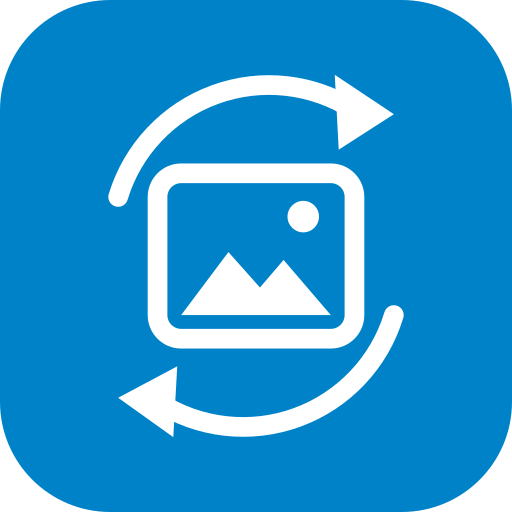

<p align="center"></p>

# PicSync

Two-way synchronisation of the **/e/OS Gallery** (all its folders, photos and
videos) with a folder in your **Nextcloud** – including deletions.
Built for the Fairphone 6 with Qt 6 (C++, Qt Widgets, qmake).

**Download:** [latest APK](https://github.com/paltenbernd/PicSync/releases/latest/download/PicSync.apk)

## Features

- Two-way sync of every folder the Gallery shows (MediaStore images and videos).
- Server layout mirrors the phone: `/<folder>/<path on phone>`, default folder
  `PicSync/<device name>` (taken from *Settings › About phone › Device name*).
- **Delayed deletions:** a deletion is detected in one run and executed in the
  next. Until then the file is locked on the other side (not re-copied, not
  changed), so a deleted photo can still be restored. Deleted server files go
  to the Nextcloud trash bin, deleted phone files to the Gallery trash.
- **Conflicts keep both versions:** if a file changed on both sides, the phone
  version is renamed to `name (conflicted copy yyyy-MM-dd HHmmss).ext` and both
  versions end up on both sides.
- Safety nets: no deletions on the first run, after a configuration change, when
  the Gallery suddenly looks empty (lost permission) or when the server folder
  disappeared.
- Background sync with Android's JobScheduler: every 15 min, 1 h, 6 h, 12 h or
  24 h, optionally only on Wi-Fi and/or while charging; survives reboots.
- "Sync now" button, progress and result notifications, history of the last
  100 runs, storage usage of the Nextcloud account.
- Language follows the phone (German and English included, English fallback).
- Login with user name and Nextcloud **app password**; the password is
  encrypted with an AES key held in the Android Keystore.

## Setup on the phone

1. Install the APK (allow installing from the browser/file manager once).
2. In Nextcloud create an app password: *Settings › Security › Devices & sessions*.
3. Open PicSync, enter server, user, app password and (optionally) the folder,
   tap **Save**.
4. Grant **All files access** (needed to read, write and delete the Gallery's
   files) and allow notifications.
5. Tap **Sync now** for the first synchronisation.

## Architecture

```
src/core/      platform independent sync core (unit tested)
  syncplanner    decision table: local + remote + last state -> actions
  syncengine     executes the plan, keeps the state up to date after each file
  statestore     last synchronised state + pending deletions (JSON, atomic writes)
  webdavclient   Nextcloud WebDAV (PROPFIND/PUT/GET/DELETE/MKCOL)
src/app/       Qt Widgets UI (dashboard, settings, history) and SyncSession
  platform/      Android layer in C++ via JNI (MediaStore, Keystore, JobScheduler,
                 notifications); desktop stand-ins for development
  android/       manifest, icons and the two Java classes Android insists on
tests/         Qt Test unit tests (run automatically after linking)
```

Background flow: JobScheduler → `PicSyncJobService` (Java) binds
`PicSyncService` (Qt service in process `:sync`) → `main()` with `-service`
→ `SyncSession` → broadcast "finished" → job ends. A lock file prevents the
app and the service from syncing at the same time.

Coding rules of this project: C++17, a comment before every function,
ownership exclusively through smart pointers (`std::unique_ptr`, `QPointer`,
Qt parent ownership only via `release()`), no lambdas. JNI handles
(`jobject`, `jclass`) are non-owning references managed by `QJniObject`.

## Building

Desktop (development and tests):

```sh
mkdir build && cd build
qmake ../PicSync.pro && make -j8   # the unit tests run right after linking
make check                         # run them again
```

Android (arm64): Qt 6.8 for Android, JDK 17, Android SDK and NDK 26.1, plus the
OpenSSL libraries from [KDAB/android_openssl](https://github.com/KDAB/android_openssl)
(`export ANDROID_OPENSSL_DIR=/path/to/android_openssl`):

```sh
mkdir build-android && cd build-android
$QT_ANDROID/bin/qmake ../PicSync.pro -spec android-clang ANDROID_ABIS=arm64-v8a CONFIG+=release
make -j8 && make -C src/app INSTALL_ROOT=$PWD/android-build install
androiddeployqt --input src/app/android-PicSync-deployment-settings.json \
    --output android-build --android-platform android-34 --gradle --release \
    --sign picsync-release.jks picsync
```

GitHub Actions (`.github/workflows/build.yml`) does exactly this on every
push to `main` and publishes the APK as the latest release.

## Licence

Copyright © 2026 Peter Altenbernd &lt;peter.altenbernd@h-da.de&gt;

PicSync is free software: you can redistribute it and/or modify it under the
terms of the **GNU General Public License v3.0 or later** (see [LICENSE](LICENSE)).
It uses Qt under the LGPL v3.
